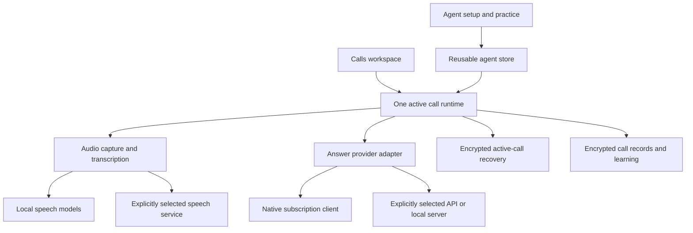

# Togle: subscriptions, dictation, agents, and work

Updated October 30, 2026. **Current scope: preserve the existing agent and call application and add dictation into other apps.** The user explicitly prefers the current workspace. The broader workspace proposal below is deferred, not the implementation plan.

## Current dictation implementation

- A configurable global shortcut (default **Ctrl+Alt+Shift+Space**) starts and stops a bounded, two-minute dictation. A separate small window uses `showInactive` and is not focusable, so the chosen text field keeps the keyboard.
- `Dictation` owns cancellation, serialized recognition, final flush, cleanup and a single insertion commit. Late results cannot enter a later job. Queues, chunks and model requests are bounded. A failed chunk leaves earlier text available for copying; a failed cleanup retains the original words.
- `DictationSpeech` freezes recognition, language and subscription choice for each recording. Claude uses installed local recognition followed by SDK cleanup. A ChatGPT account's dictation is heard by this PC's recognition (Sign in with ChatGPT doesn't include transcription), then cleaned up by ChatGPT. Cleanup gets only dictated text, without agent history, connected tools, screen context or a paid API-key fallback. An account change fails the pending request.
- Windows UI Automation runs in a separate helper process. It snapshots the foreground window, field identity, value and selection; all must still match before Unicode input. It checks the resulting value and does not retry an uncertain insertion. It does not synthesize Enter or Tab, modify the clipboard automatically, or insert into password/read-only fields. Multiline formatting, changed destinations and unsupported editors recover to Copy. Other operating systems currently use Copy.
- A separate microphone stream leaves the existing call capture objects alone. Timestamp overlap filters private dictation from Togle's microphone transcript, including late final segments. It cannot mute the user's conferencing app. Raw audio and dictation history are not persisted; only the latest result stays in memory for recovery.
- Settings adds one Dictate anywhere section. Local speech installation remains available even if calls use cloud transcription. Existing agents, chats, calls, history and navigation remain in place.

Verification includes cancellation races, short replies, account changes, no-speech, failed recognition/cleanup, concurrent call intervals, actual microphone resource cleanup, production bar IPC/layout, real Windows text inputs/contenteditable/selection/focus changes, and a known speech sample through the Claude subscription. The tests are not a claim that every custom editor or elevated window supports insertion.

## Product direction

Togle helps the user write and work in the apps they already use, using an existing ChatGPT or Claude subscription. Everyday dictation, questions about current work, and help during meetings are entry points to the same product. General is usable immediately; agents add responsibilities, project context and memory when useful. Dictation must work without choosing an agent or opening the workspace.

The intended commercial distinction is bringing an AI connection the user already has. Togle should describe which connection powers each capability and respect that connection's limits. An existing subscription does not imply unlimited inference, API credit, or speech recognition.

## Deferred workspace proposal

### Two places to interact

**The Togle bar** is the everyday entry point. It stays small and can be hidden when idle. Dictation shows only destination, listening/processing state, cancel and the immediate result. Ask opens a small agent conversation anchored to the current task. An active meeting replaces idle controls with its owner, state and a return action. Opening the workspace is optional for quick interactions.

**The workspace** is where work continues. Agents stay on the left; the selected conversation stays on the right. Recent conversations appear under the selected agent and include meetings. One conversation owns its messages, relevant transcript, evidence, action drafts and results. Context and memory are available on demand rather than occupying permanent extra columns. A private dictation history is accessible from the bar; it does not populate every agent's conversation list.

Product-level intent stays explicit:

| Intent | Start | Result |
| --- | --- | --- |
| Write my words | Hold the dictation shortcut, or click the mic | Insert words into the intended field; release ends dictation. Never submit the destination form. |
| Help with my work | Invoke Ask, or open the agent's composer | Explain, investigate, draft or perform the requested task in a conversation. |
| Help in this meeting | Accept a calendar/call prompt, or choose Start call | A live session with the selected agent, chosen audio/screen context and recoverable history. |

These are actions, not three permanent workspace modes. Speaking a sentence during dictation must not secretly turn it into an agent command. Selection rewriting is explicit and previews changed text. Shortcut bindings are user-configurable and checked for conflicts; keep existing users' shortcuts until they opt into a new binding. Hold-to-talk requires reliable key-up handling rather than the current activation-only shortcuts.

### Everyday dictation: the replacement bar

1. On activation, remember the destination application, editable control, selection/caret and a revision fingerprint. Show the destination before listening.
2. Capture microphone speech with immediate visual feedback. Support hold/release, an explicit hands-free control and Escape to cancel. Key-repeat must not start multiple jobs.
3. Stream recognition into an isolated dictation job. Personal vocabulary applies by default; project vocabulary is an explicit reusable choice. Basic transcription does not require an agent's full memory, tools, calendar or project documents.
4. Preserve names, numbers, uncertainty and meaning. Cleanup can remove fillers and resolve spoken corrections, but must not add facts or change a request into a commitment. Keep original recognition and the final text separately.
5. Revalidate the target on completion. Insert only into the same appropriate editable field and selection. A changed focus, changed selection, concurrent edit, secure field or unsupported app leaves the text recoverable and offers an explicit destination choice.
6. Never press Enter to send. Prefer native text insertion; any clipboard fallback must preserve unrelated clipboard updates and rich content, and must not repeatedly paste after an uncertain delivery.
7. Offer Undo for the exact insertion while the target revision still matches. After intervening edits, preserve the user's changes and leave the result in history. Retry retains the original job and must not duplicate delivery.

Dictation history contains destination, time, original/final text and delivery status, subject to the user's retention setting. A failed delivery is actionable from the bar. Audio retention for retry is a separate, visible choice. Correcting a word can offer a vocabulary entry with Personal or a named agent as the scope; it must be inspectable and reversible. Ordinary dictation does not silently create reusable agent knowledge.

For rewriting selected text, capture an immutable selection snapshot, show the proposed replacement and recheck the target before applying it. If the selection changed, offer the replacement for manual use. No unsupported claim that text was inserted, copied or sent.

### Agent work that continues

An agent represents a responsibility such as Northwind, Personal or a code project. Its conversations represent bounded work, not new agent identities. Each conversation has an immutable ID and owner. Viewing another agent never switches a running task or call. Composer drafts and results stay scoped to their own conversation.

The main composer offers attachments and an explicit current-screen action. Reading one screen for a question does not enable persistent watching. Context shows what will be available: selected files, permitted apps, relevant history and an explicitly selected screen source. A provider account switch rechecks grants and never automatically replays another account's context.

Agent chat can investigate and produce reviewable work. A Jira issue, message or code change should show its concrete content and destination before any approval required by the request or tool policy. Previously authorized work continues without repetitive permission prompts. Results and failures stay in the originating conversation, including retry and cancellation. External write tools are future work; the current Claude connector path remains read-only.

### Meetings as conversations

Scheduled reminders and actual call detection are separate inputs to one meeting lifecycle. Match event IDs and conference links when possible; timing alone produces a suggestion, not a confident match. Avoid duplicate prompts. An unscheduled call can create a new conversation or join an explicitly selected existing one. The reminder identifies the agent and allows changing it before capture starts.

Load attendee names and emails, not just their count, for a meeting-scoped roster. Match voice clusters to that roster and conversational evidence; label uncertain assignments and keep user corrections authoritative. Corrections can apply to one turn or all turns for that voice. Shared microphones and overlapping speech remain explicit uncertainties.

During a call, prioritize the latest useful suggestion. Keep transcript, people and screen controls available through disclosure. Group behavior is inferred when evidence is sufficient and can be overridden in the call. The persistent bar returns to the live call while the user works elsewhere; it does not duplicate the same return or end controls inside the already-open call.

Ending a call closes capture and converts the same conversation to a recap with decisions and next steps. Follow-up work uses that session's evidence. Save personal notes separately from generated summaries. Remembering a reusable decision has a visible destination and source; automatic learning respects the user's selected policy and supports Undo.

### Dictation during a meeting

One audio coordinator owns each physical input and fans out timestamped samples. A dictation gesture starts a separate job without restarting or stealing the meeting microphone. Remote transcription continues. Tag microphone intervals used for an agent instruction or dictation so they cannot trigger unsolicited assistance or become confirmed meeting decisions.

Togle cannot make a user's voice inaudible to the conferencing app. Private spoken instructions require the meeting microphone to be muted; show the actual or unknown state rather than claiming privacy. Do not silently mute or unmute an unrelated application. A dictation completion must never be inserted into the meeting chat merely because that window gained focus.

### Runtime and persistence target

| Owner | Responsibilities |
| --- | --- |
| Provider connection | Authentication, available capabilities, plan state, cancellation and native thread references. Speech support is independently discovered. |
| Agent | Instructions, knowledge, vocabulary, tool grants and memory policy. |
| Work session | Immutable owner, messages, activity, evidence references, action drafts and results; optional meeting capture segment. |
| Dictation job | Audio/recognition state, target snapshot, text revisions and delivery receipt; private history by default. |
| Audio coordinator | Device lifetime, timing, purpose-specific consumers, bounded queues and recovery. |
| Desktop integration | Global gestures, focused-field access, insertion, clipboard preservation and target revalidation. |
| Context service | Explicit source selection, bounded screen buffers and request-time evidence selection. |
| Scheduler | Prioritize waiting-user work and live assistance; postpone summaries, memory proposals and indexing. |

Keep `CallSessions`, recovery and agent IDs compatible while introducing work sessions. Adapt existing calls into the new history view before migrating their storage. Provider-native thread IDs remain adapter-owned. Do not widen connected-tool permissions or reinterpret prior audio consent as a side effect of migrating the UI. Keep General immediately available.

Raw dictation must remain usable when a reasoning provider is unavailable, if an independently available speech engine is ready. Optional rewriting and agent work show the provider's real state. Present subscription sign-in first; advanced API settings remain optional. Do not silently switch to billable API usage. This is a product capability requirement, not an assumption that either subscription includes a speech API.

### First-use flow

Connect ChatGPT or Claude, discover supported capabilities, prepare speech, then perform one short dictation into a safe practice field. Offer the recommended speech setup appropriate to the PC without exposing model-lane configuration. The first success is inserted, editable text. Calendar and work-app setup appear when the user starts preparing meetings or project work. Templates help create specialized agents after that first success; General needs no configuration.

### Delivery order and acceptance

| Stage | User outcome | Required evidence |
| --- | --- | --- |
| 1. Replace daily dictation | Write into Slack, Gmail, editors and documents from a shortcut | Real Windows insertion, cancellation, focus/selection changes, AltGr layouts, clipboard races, unsupported fields and recovery; no duplicate or wrong-window insertions in the scenario suite. |
| 2. Continue agent work | Ask from anywhere and resume bounded conversations | One owner per conversation, per-session drafts, active task survives navigation, source visibility and reviewable action results. |
| 3. Combine meetings and dictation | Use both throughout a workday | One mic pipeline, call prompts including unscheduled calls, back-to-back deduplication, attendee roster, live return and no cross-session audio/text leakage. |
| 4. Improve from real use | Fewer repeated corrections and useful reusable memory | Scoped vocabulary, source-backed memories, conflicting corrections, Undo and deletion propagation. |

Measure end-of-speech to editable text, first useful agent response, successful insertion rate, correction rate and recovery rate. Record cold/warm, local/cloud and device conditions separately. A proposed initial dictation target is visible listening feedback within 100 ms and warm end-to-editable text p95 under 1.5 s for short utterances on the reference Windows PC; these are acceptance targets, not measured results. Recognition and insertion must not wait for background summaries or memory learning.

The prototype demonstrates insertion/undo, focus-change recovery, rewrite review, agent/session navigation, concrete action preview, persistent live-call return, individual suggestion folding, source choice and post-call memory Undo. It does not implement global input hooks, actual insertion into other apps, voice capture, live model requests or external writes.

## Current implementation: the three concepts users need

| Concept | Owns | Does not own |
| --- | --- | --- |
| Connection | A provider account, its capabilities, and usage status | A copy of each agent's memory |
| Agent | Its chat, call history, reusable instructions, skills, approved answers, and knowledge | Automatic reuse of private facts from every call |
| Call | A bounded session with one chosen agent, notes, transcript, replies, and follow-up questions | Provider credentials or another call's active context |

The UI calls a session a **call**. Imported Claude Code/Codex sessions and exported AI chats are external knowledge sources; they are not Togle call sessions.

Hermes provides the useful underlying distinction: its bots are persistent profiles with a canonical bot chat, while sessions are individual saved conversations. Togle adopts that distinction without introducing bot group chats, routines, or messaging-platform concepts into the live-call flow. Sources: [Hermes Bot Mode](https://hermes-agent.nousresearch.com/docs/user-guide/bot-mode), [Hermes sessions](https://hermes-agent.nousresearch.com/docs/user-guide/sessions).

## Interface

The app opens with a persistent agent list on the left and the selected agent’s chat on the right. General is ready without creating an agent. Clicking another agent switches the chat directly and preserves each agent’s draft. The sidebar is the single installed-agent list; its plus button creates an agent, Explore agents opens the catalog, and Settings configures connections. Call history belongs to the selected agent. Search appears when the agent list grows. Narrow windows use an avatar rail; its toggle opens a labelled list with keyboard focus containment and Escape to close. Existing compact window sizes are widened once for this layout; later manual sizes are respected.

Each agent has three workspace tabs:

- **Chat:** teaching, preparation and practice, with Start call beside the message box. Attachments imported here are reusable knowledge; call notes stay with the call.
- **Live Call:** the owning agent?s current transcript, suggestions and call controls, with an explicit selected tab. With no current call it offers Start call. When another agent owns a running call it offers a return action without changing ownership.
- **Call History:** only that agent?s saved records. A running record opens live assistance; an ended record opens Overview, Transcript, Replies and Learning. Workspace tabs remain available for returning to chat or the live call. More contains rename, export and delete. Browsing history does not change the active runtime.

**Agent settings** is a separate configuration page. Knowledge contains profile editing, instructions and reusable knowledge; Learning contains mode selection, pending lessons and reversible changes. Share agent is explicit in its header. Delete agent is separate from routine actions and explains when the current call prevents deletion. Blank knowledge sections are omitted. Shared account connections remain in the app’s Settings.

Deleting an agent retains its saved calls. **Settings → Privacy → Calls from removed agents** opens those records for inspection, export or deletion. That archive excludes installed agents, whose calls remain in their own workspace. Learning cannot apply a retained record to an unrelated agent.

Menus render as viewport overlays, flip when space is limited, and close on outside interaction, Escape or a hidden trigger. Arrow keys move through actions and Escape returns focus to the trigger. AI-chat import and manual screen selection use bounded modal dialogs; screenshot previews have an explicit close action and keyboard dismissal. Save failures retain drafts and show an error instead of displaying an unsaved setting as successful.

Call setup identifies the owner, offers optional notes, and asks for a screen or audio-only capture. The owner is committed before capture starts. Cancelling setup preserves the prior call. Opening another agent while a call runs does not change its owner.

During a call, the primary actions are Suggest reply and End call. Auto can be paused without stopping transcription. Starting asks which screen or window Togle can watch, or offers audio only. Screen context has visible pause, resume and source controls; the AI requests visual evidence on demand from a bounded local buffer. Manual snapshots and summaries stay in Call tools. Audio inputs show whether the microphone and call audio are available; a missing input can reconnect independently. See [screen context](screen-context.md) for capture, upload and lifecycle boundaries.

The call workspace is labelled Live call or Call ended, with Chat and Calls links back to the owning agent. It does not mark the saved Calls tab as selected while showing a different view. The chat composer has one Start call action, and the compact call composer has one End call or Resume call action. After a call, follow-up questions still use that call’s context. Chat returns to the agent’s reusable conversation. The current saved record offers Ask about call to reopen the runtime; an unsaved current call has one local entry under its agent’s Calls tab, without creating a history record. Starting from chat creates a new session and clears the previous runtime before capture while preserving saved history. Cancelling setup preserves the earlier runtime. No elapsed-time heuristic silently decides whether a different customer belongs to the same session.

Every new call is archived independently of an AI summary, including short calls and calls where no speech was captured. Remember calls controls saving transcripts and suggestions as well as summaries. Older summary-only records remain inspectable and are marked as such. Screen images and raw audio are not copied into the archive. A live call cannot be deleted, and its owning agent remains fixed until New call.

Agent creation starts with included local templates. Copying a template creates an independent agent; its future learning does not mutate the template or other copies. Chat is for teaching and practice, Knowledge exposes instructions and remembered information, and Learning exposes mode selection, pending proposals, change history, and Undo.

## Runtime boundaries

The Electron main process owns runtime state, credential boundaries, provider execution, and disk writes. React presents that state; changing visible pages does not own or restart execution.

Current storage is retained rather than migrated destructively:

- `AgentStore` owns reusable setup. Its long-lived conversation is for training and practice.
- `CallView.key` identifies the active call. `CallState` holds its brief, group setting, transcript, corrections, and running notes. `CallFile` saves crash recovery.
- `CallSessions` owns durable records, independently of whether a review produced a summary. Each encrypted file has an immutable call ID and owning agent ID, while an encrypted index supports browsing. User titles survive subsequent capture updates. The index can recover orphaned records after an interrupted write.
- `PastCalls` remains the compact, agent-scoped recall index. History merges old summaries without inventing missing transcripts, and deleting a durable record removes its corresponding recall summary.
- Provider-native thread/session identifiers belong to the adapter. They must not become the application's call ID or authorize replay of another customer's conversation.

## Enforced isolation

1. The Calls workspace shows only blocks belonging to its call key. Agent setup and earlier calls are separate views. Composer drafts are keyed independently for a call and an agent chat.
2. Call preparation uses `setBrief`, not the training model. Notes can hold 3,000 characters; important details after the previous 500-character boundary survive.
3. Looking at another agent does not change `activeAgentId`. The main process rejects changing or deleting the active call's agent while listening.
4. Training another agent cannot read the active call. Agent setup cannot overwrite a live call's brief or another agent's call context.
5. New call waits for main-process cleanup. Pending renderer saves and capture starts cannot race ahead of it.
6. The hearing pipeline invalidates old work at a call boundary. A late final, pause, or preview from the old call cannot become part of the next call. New transcription delivery does not wait for an old provider request.
7. Recalled summaries are checked against the current agent, call generation, and brief before they are published. An old lookup cannot replace the new customer's context.
8. Subscription credentials stay with their existing authentication owner. Agent creation and history browsing do not copy credentials or start a paid fallback.
9. The main process owns automatic learning. A substantive ended call is reviewed after a short delay; unchanged source content reuses the previous review. Calls interrupted during a review become retryable. Reopening a call does not reapply a lesson that the user undid.
10. Review proposals and change references are persisted with the call. Approval accepts only selected items from the stored proposal and requires its current review ID. Concurrent or stale decisions cannot apply another proposal. History and agent chat display the same decision state.

## Subscription integrations

General settings starts with one Accounts library for subscriptions, named API connections and local model servers. Each named API has its own encrypted key and endpoint; public metadata and model catalogs cross IPC. Adding or reconnecting a connection preserves the default. Default AI offers exactly three versioned task recipes: Claude, ChatGPT and Mixed. Each assigns an account, model and reasoning effort to quick answers, deep answers, screen reading and background work. Accounts for presets handles work/personal choices; Customize task models can also use APIs and local models. See [the recipes and live evaluation](ai-presets.md).

Agents have separate Settings, Knowledge, Skills and Learning tabs. AI, speech and voice typing independently inherit General preferences until overridden. Agent settings reuse the General controls, including complete task recipes. Resetting one section preserves other overrides and General settings. A call snapshots all four AI routes plus speech configuration and uses account-pinned providers. Later edits apply to new calls. Plan checks use the account serving the actual task, so a limited GPT quick route does not block a Claude deep route. Existing single-provider settings remain usable. Catalog requests identify their connection directly, never switch defaults, and use a bounded native-startup pool and short cache.

The **Speech** card exposes just **Account** and **Language** for both meeting transcription and hold-F9 voice typing. Claude profiles supply speech themselves; a ChatGPT profile's speech is heard by this PC, since Sign in with ChatGPT doesn't include transcription. Either can be used independently of the answer account. Calls pin the speech profile, signed-in identity and language for their lifetime; the status reports that pinned account rather than a newly selected default. Each F9 recording snapshots its account and language before capture. Reauthentication cannot silently send the next audio clip through a different identity, and late results are checked again before delivery.

Voice typing normally follows that shared setup. **Advanced speech settings** contains both exceptions: an alternate **Call transcription** engine and another **Voice typing account** for work/personal separation. Active exceptions remain visible outside the disclosure; **Use this account for both** resets them in one save. A migration preserves distinct existing call and dictation accounts and removes only redundant overrides. Existing local, API-key and compatible-server configurations remain available. Subscription limits never trigger a silent paid API or local dictation fallback; model downloads still require a user action. The Voice typing card shows the shortcut instruction, voice-bar switch and cleanup switch. Microphone and shortcut configuration share a separate disclosure.

Meeting reminders belong to an agent and an explicitly selected Claude calendar account. They appear only in the agent's Settings tab. Events and dismissals carry the owner; starting assistance from a reminder uses that agent regardless of the currently visible chat. Independent calendars keep independent caches, and all calendar reads pause during calls. Existing General reminder preferences migrate to their selected owner. The UI shows the connected account and up to three upcoming meetings, with distinct disconnected, checking, error and empty states. General settings content has a maximum width of 880px for readability.

F9 uses the selected agent's effective voice preferences outside a call and the call owner's preferences while listening. The bar receives those effective preferences separately from General settings and reflects the correct hold/toggle mode. Recordings preserve their starting account and settings while pages or preferences change. The native shortcut remains shared.

A ChatGPT account's speech is heard by this PC (Parakeet, with Whisper for other languages and unclear speech), with automatic language detection: OpenAI's Sign in with ChatGPT doesn't include audio input or transcription. Claude uses the native account-backed voice service for both modes: streaming while F9 is held, or bounded utterance clips during calls. Its [published dictation languages](https://code.claude.com/docs/en/voice-dictation) are Czech, Danish, Dutch, English, French, German, Greek, Hindi, Indonesian, Italian, Japanese, Korean, Norwegian, Polish, Portuguese, Russian, Spanish, Swedish, Turkish and Ukrainian. Claude requires an explicit supported language; automatic detection and unsupported choices show a setup warning instead of silently becoming English. A supported language hint never causes Togle to strip another writing system from a returned transcript. Dictation cleanup preserves the original language and mixed-language words; it does not translate them.

| Route | Current implementation | Product boundary |
| --- | --- | --- |
| Claude subscription | Official Claude Agent SDK/native Claude Code authentication; separate from the API-key lane | Experimental in Togle. Account entitlements and plan limits apply. Public login offerings need a provider-approved path. |
| ChatGPT plan | OpenAI's Sign in with ChatGPT with ChatGPT plan usage: Togle registers per account (`dynamic_agent_client`, a host ID per computer), then calls the public Responses API (`store: false`, `stream: true`) | Self-serve for open-source, locally run apps like Togle. A paid or hosted version needs OpenAI's approval first. Text and images only: no transcription. |
| API key / compatible endpoint | Explicit provider and model selection | Usage follows that provider's billing. Never switch here silently after a subscription limit. |
| Local speech | Installed Whisper/Parakeet path | Independent of the answer provider; no inference API key is needed for this path. |

OpenAI's [Sign in with ChatGPT for open-source apps](https://developers.openai.com/siwc/token-sharing-open-source) is the contract Togle follows: the browser sign-in with PKCE and a loopback callback, the ID token checked against OpenAI's published keys, the plan permission (`chatgpt.tokens.use.direct`) checked before any request, rotating refresh tokens, and revocation on sign-out. Requests leave out the fields that route rejects, tools go in a namespace, and usage-limit errors pause automatic answers and point to ChatGPT's settings, which show the plan's usage. Togle shows "Continue with ChatGPT", "You're using your ChatGPT plan" once after the first sign-in, and "Using ChatGPT plan · Manage usage" during calls, per OpenAI's UI guidelines.

Anthropic's current [plan help page](https://support.claude.com/en/articles/15036540-use-the-claude-agent-sdk-with-your-claude-plan) says signed-in SDK and `claude -p` usage continue drawing from subscription limits. Its [Agent SDK overview](https://code.claude.com/docs/en/agent-sdk/overview) separately says third-party developers need prior approval to offer Claude login or plan rate limits in their products. Technical success in a local test therefore does not establish permission to market that login in a public product. Resolve that offering boundary before distribution; keep the provider adapter replaceable.

Claude approval is unconfirmed as of 2026-11-02. The [legal and compliance guidance](https://code.claude.com/docs/en/legal-and-compliance) also allows users to authenticate to an unmodified Claude Code binary hosted in a product under stated conditions. Ask Anthropic to determine how that allowance applies to Togle's embedded SDK arrangement. Review speech separately: `src/main/auth/claude-speech.ts` reads a runtime-managed OAuth token for the direct `voice_stream` connection in `src/main/stt/claude-speech.ts`; this is distinct from SDK text inference and must not be assumed covered by SDK permission.

## Call persistence and learning

The `CallSession` repository is implemented with an immutable ID, owning agent snapshot, user-editable title, explicit lifecycle, private preparation, timestamped transcript, suggestions, and learning result. The current call key is the migration key. The existing active recovery file remains in place, and old summary-only calls are retained as historical records.

Replies that leave the live window remain in the archive, and streaming updates replace the same reply by ID. Per-call archive bounds are 20,000 transcript lines and 2,000 suggestions. Completed-call retention and current-call crash recovery are separate: switching Remember calls off stops new history records while the active call can still be recovered.

Writes and lifecycle transitions serialize. Deletion wins over late capture updates; renaming cannot be overwritten by a later save. Exports contain call content and learning history, without provider credentials. Opening an older call is an inspection action, not an implicit resume. A provider adapter can be replaced without rewriting stored calls or changing their ownership.

`CallLearning` serializes review and approval decisions per call. The model proposes lessons; the trust rules separately stage changed facts, amounts, and deals. Automatic mode applies fitting reusable additions. Ask-first and manual-only modes stage all findings. Model failures, interrupted reviews, and proposals awaiting approval remain visible. Removing an agent cannot redirect its pending lessons into a fallback profile. Future session work can add scoped attachments and explicit historical resume without creating a second bot runtime or duplicating the agent store.

### Evidence for assistance learning

Assistant skills describe Togle's behavior during a call. Procedures reported by participants are historical reference material. Earlier call-derived skills without an explicit purpose remain intact and are interpreted as reference; manual and chat-taught skills remain assistance policies. Reference retrieval ignores conversational stop words and keeps only matching material. The active prompt labels reference as data, and remembered facts retain source attribution and a reminder to verify current status.

The review can propose `ASSIST` entries, each with correction evidence. Actual correction indices are checked against the call; invented ids and approvals without a correction cannot activate a new assistant policy automatically. Unsupported proposals are staged in Learning. Exact answers require the user's actual approval or correction before joining Approved answers. The main process attaches the source call and timestamp to applied facts and skills. Skill edits increment a revision, and Undo restores prior content and fact provenance. Shared packages retain assistance/reference purpose while excluding private source-call ids.

Saved answers carry the context supplied to the model: remembered facts, assistance-policy ids and revisions, and selected reference material. The UI exposes this under Context for this answer. Inclusion is recorded separately from the keyword-based match count; neither claims to measure the model's internal reliance. Reviews prioritize policies actually supplied in saved answer context. Review cache keys include the learning-contract version.

## Verification

Local performance measurements and work bounds are documented in [performance.md](performance.md). History renders incrementally while search and export retain the full saved record. The repository uses a bounded cache of decrypted JSON, independent values for each reader, and serialized operations; encrypted atomic writes remain in place.

Automated checks cover encrypted call records, empty and short calls, restart recovery, ownership, rename/delete races, template independence, automatic and ask-first learning, selective approval, stale decisions, Undo, duplicate review suppression, and deleted agents. The UI suite exercises inspection, management and learning at 400px and 640px. `npm run test:native` also drives the actual Electron main process, real IPC, OS encryption, and production renderer using an isolated profile, a local transcript hook, and no account, device capture, or model request.

Shared-speech checks cover both account adapters, account changes during refresh and response reading, pinned call language, migrations, Claude permissions and language errors, and mixed-script text reaching a focused-field insertion unchanged. The 400px and 960px UI checks cover the shared selector and optional overrides. `npm run test:speech:live` is an opt-in network check using the existing signed-in profiles and a known synthetic English fixture through both production speech adapters. It does not capture devices, read meetings or change user preferences. This English fixture validates connectivity and dispatch, not multilingual acoustic accuracy or provider approval.

The settings UI checks also exercise two-field setup, visible exceptions, reset success and failure, and calendar connected/disconnected/checking/error/empty/off states at 400px, 960px and 1760px. Run that subset with `node test/ui-launch.cjs --settings-only` after building the renderer and test bundle.

Saved memory is separate from live prompt size. Approval and manual editing preserve short facts beyond the 4,000-character working context. Live requests select relevant facts with recent facts breaking ties; search_memory retrieves omitted facts with provenance. Daily-update questions also read recent reports belonging to the same agent, with privacy settings respected. They permit enough read-only tool rounds for identity/resource discovery, search and source inspection. Replies distinguish completed, blocked and unverified work, avoid attributing a colleague?s work to the user, and use an honest one-sentence fallback when no evidence is available.
