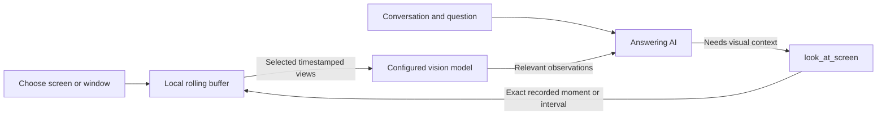

# Automatic screen context

Starting or resuming a call asks which screen or window Togle can watch. Picking a source starts audio capture and monitoring; **Start with audio only** starts without screen access. Closing the picker cancels starting the call. A source can be added later, paused, resumed, or changed in the call controls. A missing source never falls back to another display.

## Capture and upload are separate

The renderer samples the selected source every 500 ms, stamping the pixels before JPEG encoding finishes. It reuses its capture canvas. The main process keeps up to two minutes of timestamped history, bounded to 256 samples and 64 MiB of distinct image bytes. Identical images share their storage while every sample retains its timestamp. Memory pressure can shorten the available history; its actual bounds are exposed to the AI. Meaningful visual changes additionally retain a local timeline snapshot, at most once every two seconds, without a background description request. Unchanged samples stay only in the rolling buffer. Mouse movement and continuously moving video tiles are filtered by the change detector; slides, scrolls, and edits can be retained. Source changes and call end invalidate pending captures.

The answering model receives a `look_at_screen` tool with a specific visual question, a `frame`, `range` or explicitly requested `live` view, and mandatory `from_ms` / `to_ms` timestamps. A still uses equal start and end times. A range selects up to six samples from that exact interval, within a 6 MiB upload budget. Repeated images are uploaded once with their sample times listed. The result reports the requested interval, actual captured timestamps, and missing sampling intervals. It is a sampled sequence; provider adapters accept images rather than a continuous video clip.

## Speech time, not decision time

Speech and screen samples share the call clock. The speech pipeline supplies the original audio segment start and end, including answers anticipated during a pause. Transcription completion time and model response time do not replace those timestamps. Clock corrections use the same adjustment for audio and screen samples.

Phrases such as “as you can see on my screen” mark the original utterance interval immediately. Each answer freezes its speech-time anchor before knowledge retrieval or model inference begins. Its prompt includes exact numeric timestamps for the anchor, the last eight utterances, and spoken screen references, including older references whose pictures may have expired. A question identified in a newer utterance takes its own original audio interval rather than inheriting an unrelated older reference. The model can select a specific moment or interval from that timeline. It must not estimate “a few seconds ago” from when the tool happens to run.

A historical lookup never requests a fresh screenshot and never substitutes a later frame. The tool rejects a historical timestamp after the original question was received, even if the buffer now contains it. A point lookup selects a nearby preceding sample and reports its actual time. An unavailable or evicted moment is reported as missing, with the retained bounds. A live view is available only for an explicit request for a current/fresh screen and reports its own request and capture times. The screen controls provide expandable details showing the spoken reference, requested time, actual captured samples and gaps. Recording resolution is approximately 0.5 seconds, not word-level or frame-perfect alignment.

The configured vision lane reads the selected images and returns concise factual observations to the answering model. Both requests use the existing provider and subscription/API configuration. The vision reader treats text inside screenshots as untrusted evidence, not instructions, and cannot infer motion between selected samples. Summaries and historical agent tests do not receive the screen tool. Manual snapshot shortcuts remain explicit actions through the existing snapshot path.

## Lifecycle and limits

Each selection gets a new scope ID. Frames and tool calls from old scopes are rejected, including a window closing, a source change while capture opens, and late encodes after Stop. Incoming captures older than five seconds are rejected before clock normalization, so a delayed encoder cannot impersonate a system-clock change. The two-minute history is retained from frames already accepted locally. Expired images are removed even when capture stops delivering new samples. Pausing aborts pending lookups and discards the local buffer. Ending a call, starting a new call, reloading the renderer, or quitting stops monitoring. Screen permission failure leaves audio and suggestions running. A recovered call asks for a source again; capture access is not restored from history. A video capture without an explicitly prepared source is denied rather than falling back to another display.

A look uses at most two tool invocations per answer part, reuses observations for the same time selection briefly, and has a timeout. Old, oversized and out-of-order frames are rejected. An unchanged slide retains its observation timestamps. The selected source, pause control, requested interval, and AI reading activity stay visible during the call. Automatic monitoring requires a provider with tool support.

Simultaneous requests for the same visual question and timestamps share one provider operation. Cancelling one answer leaves other interested answers running; cancelling all of them aborts that operation. Independent concurrent operations return the activity indicator to watching after the last operation ends. A live refresh requested during JPEG encoding queues another capture, and only a sample taken at or after the live request can satisfy it. `imagesSent` counts distinct images submitted to the provider, including interrupted submissions; `reads` counts completed observations.

## Verification

`npm test` covers local-only buffering, temporal selection, image and byte limits, deduplication without losing timestamps, gaps and missing history, cancellation, source isolation, audio-clock corrections, and the model choosing whether to call the tool. The delayed-decision scenario changes the screen after the original utterance and verifies that transcription/inference latency cannot move the lookup to the later image. Recorder tests cover denied access, stopped streams, late results and timestamps retained through asynchronous encoding. `npm run test:ui` exercises source selection and timing details at 400px and 640px. `npm run test:native` exercises the real IPC lifecycle with fictional capture sources.

`npm run test:screen:live` optionally uses the official Claude CLI sign-in in a fresh profile, with a fictional chart and at most four provider stream calls. After a spoken screen reference, the chart changes from Beta = 35 to Alpha = 99 before the AI decides. The check verifies that Claude retrieves the earlier spoken interval and answers Beta = 35, and that an ordinary question sends no image. The report includes requested and actual capture times. No desktop image or real call is used; results go to `test/.work/screen-live/result.json`.

`npm run test:screen:capture` exercises actual Windows window capture through the production renderer recorder, preload, Electron display-media handler and IPC. It briefly displays a fictional blue chart, selects only that window, verifies decoded JPEG pixels, changes the chart to red, and checks pause/resume, call end, source closure and denial of unprepared capture. It uses an isolated profile and no microphone or AI request. After building, `node test/screen-capture-launch.cjs --live` adds a real Claude subscription request: it checks that every timestamp selected by the AI belongs to the earlier blue chart and that the answer is Beta = 35. Reports contain sample metadata, timestamps and the answer, without screenshot bytes, in `test/.work/screen-capture/`. Unexpected main-process promise rejections fail this check.
